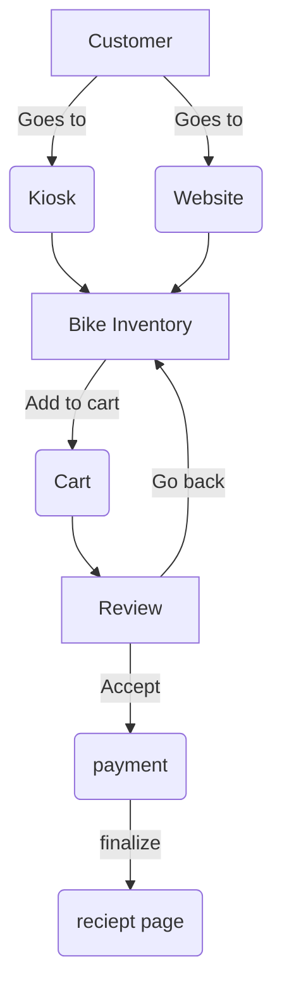

## Technical Design Document  
_Yaremi Dominguez_  
_November 2, 2026_  

**Part 1**  
_Overview_  
The bike shop software system is meant to be used by customers and employees for making reservations by viewing available inventory, and by management to view reports, manage reservations and payments, and manage inventory. The customers can also make reservations through the kiosk.

_Actors_
* Customer: creates reservation, and pays
* Bank Authotization Service: to verify correct account credentials, and approve the amount/cancel amount
* Employee: create/manage reservations
* Kiosk: used to make reservations, view inventory andavailability
* Manager: Pull reports, manage inventory, manage reservations
* Bike maintenance:keep real-time info on bikes available to bike shop  

_Goals_
* Allow customersto view inventory
* Allow reservations
* Have secure payment processing
* Allow kiosk reservations
* Allow employee access to reservations
* Real-time bike inventory and reservations  

_Non-goals_
* We are not focusing on a charge process for unreturned bikes
* We are not including outreach ads
* We are not focusing on how to connect the bike maintenance to the bike shop
* We are not focusing on employee scheduling
* we are not including rewards program    
  
_constraints_  
* Kiosk interface is the same backend api as the website  
* inventory is real-time
* No overlapping time slots
* User data handling must comply with CCPA and GDPR, including the ability to export and delete a customer's data on request.
* Employees and manager must authenticate using the shop’s existing login system.  

_Assumptions_  
* There will be no connectivity issues when creating reservations
* peak trafficis during the weekends
* bike inventory changes infrequently
* bike shop prices change infrequently
* Customers return the bikes on time, unless otherwise communicated
* most reservations are made online

_Non-Functional Recs_
* inventory updates need to reflect online within 1 minute of changes
* The reservation process is no more than 4 steps
* Must be able to handle 100 requests at the same time
* Employees and manager need authenticated access
* Bike innventory additions/removals shouldbe possible without redesigning to database
* Kiosk meets accessability guidelines  

_Component Diagram and Description_

|Component| Description |
|---|---|
|**Kiosk**|Shows all available bikes, allows user to create reservation in store.
|**Website**|Shows all available bikes, allows user to create reservation anywhere anytime.
|**Bike Inventory**|real-time bike availability
|**Cart**|users specific cart with bikes they want to rent.
|**Review**|Before paying,users see this screen to confirm their reservation.
|**Payment**|This processes user payment.
|**Receipt Page**|This is the last page a user sees and it has confirmation the payment went through and the successfully created a reservation.

