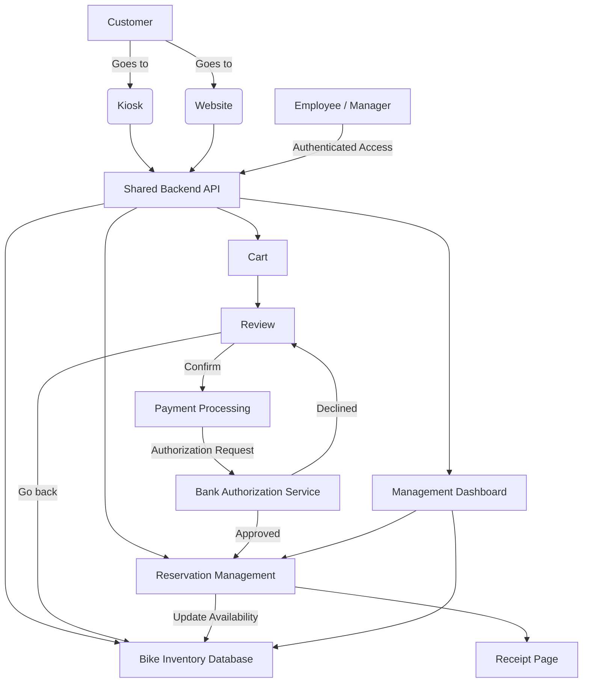

## **Technical Design Document**
*\_Yaremi Dominguez\_*  
*\_November 2, 2026\_*  

**\*\*Part 1\*\***  

*\_Overview\_*  
The bike shop software system is meant to be used by customers and employees for making reservations by viewing available inventory, and by management to view reports, manage reservations and payments, and manage inventory. The customers can also make reservations through the kiosk.

The system will use a shared backend API to connect the website and kiosk to the same database. This ensures that inventory, reservations, and payment information stay consistent across both platforms. When a reservation is successfully completed, the inventory will automatically update to prevent another customer from reserving the same bike during an overlapping time slot.

*\_Actors\_*
* Customer: Creates reservations, views available bikes, selects rental time slots, and pays for reservations.
* Bank Authorization Service: Verifies payment information and authorizes or cancels payment amounts.
* Employee: Creates and manages reservations, assists customers, and accesses reservation information.
* Kiosk: Provides an in-store interface for creating reservations and viewing inventory and availability.
* Manager: Pulls reports, manages inventory, and manages reservations.
* Bike Maintenance: Provides information about bike availability and maintenance status to the bike shop system.

*\_Goals\_*
* Allow customers to view available inventory.
* Allow customers to create reservations.
* Have secure payment processing.
* Allow customers and employees to create reservations through the kiosk.
* Allow employees to access and manage reservations.
* Maintain real-time bike inventory and reservation information.
* Prevent customers and employees from reserving bikes that are already reserved or unavailable.
* Provide confirmation and receipt information after successful reservations.

*\_Non-goals\_*
* We are not focusing on a charge process for unreturned bikes.
* We are not including outreach ads.
* We are not focusing on how to connect bike maintenance to the bike shop.
* We are not focusing on employee scheduling.
* We are not including a rewards program.

*\_constraints\_*  
* Kiosk interface uses the same backend API as the website.
* Inventory must be updated in real time, with changes reflected online within one minute.
* No overlapping reservation time slots for the same bike.
* User data handling must comply with CCPA and GDPR, including the ability to export and delete a customer's data upon request.
* Employees and managers must authenticate using the shop's existing login system.
* Payment information must be handled securely and must not be stored directly in the bike shop database.
* The system must prevent unavailable bikes from being selected during the reservation process.

*\_Assumptions\_*  
* There will be no connectivity issues when creating reservations.
* Peak traffic is during the weekends.
* Bike inventory changes infrequently.
* Bike shop prices change infrequently.
* Customers return bikes on time, unless otherwise communicated.
* Most reservations are made online.
* The bank authorization service will be available when payments are processed.
* Each bike will have a unique identifier in the inventory database.
* Customers will provide accurate reservation and payment information.

*\_Non-Functional Recs\_*  
* Inventory updates need to reflect online within 1 minute of changes.
* The reservation process should be no more than 4 steps.
* Must be able to handle 100 requests at the same time.
* Employees and managers need authenticated access.
* Bike inventory additions/removals should be possible without redesigning the database.
* Kiosk meets accessibility guidelines.
* Reservation creation and inventory updates must be processed consistently to prevent double bookings.
* The system should provide clear error messages when a bike becomes unavailable during the reservation process.
* Payment information must be transmitted securely using encrypted connections.
* The system should maintain accurate reservation records and payment statuses.
* The website and kiosk should provide a consistent user experience and display the same inventory information.

*\_Component Diagram and Description\_*

|Component| Description |
|---|---|
|**\*\*Kiosk\*\***|Shows available bikes and allows customers or employees to create in-store reservations. Uses the same backend API as the website to ensure inventory stays consistent.|
|**\*\*Website\*\***|Shows available bikes and allows customers to create reservations online. Customers can search bike categories, select rental dates and times, and complete payment.|
|**\*\*Shared Backend API\*\***|Connects the website and kiosk to the database and handles requests involving inventory, reservations, carts, and payments. It validates requests and ensures both interfaces use the same information.|
|**\*\*Bike Inventory\*\***|Stores bike information, including unique bike IDs, categories, models, prices, and availability status. Inventory availability is checked before a reservation can be completed.|
|**\*\*Cart\*\***|Stores the customer's selected bikes, rental dates, times, and calculated rental costs before checkout. The cart is associated with the current customer or kiosk session.|
|**\*\*Review\*\***|Allows users to review their selected bikes, rental time slots, customer information, and total price before confirming payment. Users can return to inventory to make changes.|
|**\*\*Payment Processing\*\***|Sends payment requests to the bank authorization service. If payment is approved, the system continues with reservation creation. If payment is declined, the user is notified and can retry.|
|**\*\*Bank Authorization Service\*\***|External service responsible for validating payment information and approving or declining payment transactions. The bike shop system receives the authorization result without storing sensitive card information.|
|**\*\*Reservation Management\*\***|Creates and stores confirmed reservations. Checks bike availability and prevents overlapping reservations for the same bike. Updates inventory availability after a successful reservation.|
|**\*\*Receipt Page\*\***|Displays reservation confirmation after successful payment and reservation creation. Includes reservation number, selected bikes, rental date and time, and payment confirmation.|
|**\*\*Management Dashboard\*\***|Provides employees and managers with authenticated access to upcoming reservations, inventory information, and management functions. Managers can also access reports and manage inventory.|
|**\*\*Bike Inventory Database\*\***|Stores persistent bike and inventory records. Supports adding, removing, and updating bikes without requiring changes to the database structure.|
|**\*\*Reservation Database\*\***|Stores reservation records, including customer information, bike IDs, rental time slots, reservation status, and payment status.|

*\_Database Design\_*

The system will use a relational database to store customer, bike, reservation, and payment information. Each record will have a unique identifier to allow the system to connect related information.

The main database tables will include:

* **Customer:** Stores customer ID, name, email, phone number, and other required contact information.
* **Bike:** Stores bike ID, model, category, price, and current availability status.
* **Reservation:** Stores reservation ID, customer ID, rental date, start time, end time, reservation status, and total cost.
* **Reservation Bike:** Connects reservations to individual bikes using reservation ID and bike ID. This allows one reservation to contain multiple bikes.
* **Payment:** Stores payment ID, reservation ID, transaction amount, authorization reference, and payment status. Sensitive card information will not be stored.
* **Employee:** Stores employee information and access roles, using the existing shop authentication system.

*\_System Functionality\_*

**1. Inventory Management**

When a customer opens the website or kiosk, the system requests the current bike inventory from the backend API. The inventory database returns bikes that are available for the selected rental date and time.

Availability will be determined by checking the bike's current status and existing reservations. A bike will only be displayed as available if it is not marked unavailable and does not have an overlapping confirmed reservation.

**2. Reservation Creation**

When a customer selects bikes and a rental time slot, the system stores the selections in the cart. Before completing the reservation, the backend performs another availability check to ensure that the selected bikes have not been reserved by another customer.

The reservation process will use a database transaction to prevent two customers from successfully reserving the same bike for overlapping time slots. If a bike becomes unavailable before checkout, the system will block the reservation and display an error message. The user can then select an alternative bike.

**3. Payment Processing**

After reviewing the reservation, the customer submits their payment information. The backend sends the payment request to the bank authorization service.

If payment is approved, the system creates the reservation and records the payment status as successful. If payment is declined, the system displays an error and allows the customer to retry.

The system will only display a successful reservation confirmation after payment authorization and reservation creation have both completed successfully.

**4. Employee and Manager Access**

Employees and managers will log in using the shop's existing authentication system. After successful authentication, the backend will determine which functions the user is authorized to access.

Employees can view upcoming reservations and access inventory information to prepare bikes for customers. Managers can additionally manage inventory, reservations, and reports.

**5. Inventory and Reservation Updates**

Whenever a reservation is successfully created or an inventory record is changed, the backend updates the database. The website, kiosk, and management dashboard retrieve the latest information through the shared API.

Inventory changes should be reflected across the system within one minute. This helps employees prepare for reservations and prevents customers from selecting bikes that are no longer available.

*\_Error Handling\_*

* **Unavailable Bike:** If a selected bike becomes unavailable during checkout, the system blocks the reservation and displays a message. It can suggest other available bikes in the same category.
* **Payment Declined:** If the bank authorization service declines a payment, the reservation is not confirmed and the customer is notified.
* **Invalid Information:** If required customer or reservation information is missing or incorrect, the system displays an error and requests that the user correct the information.
* **Failed Reservation:** If reservation creation fails, the system will not display a successful confirmation. Payment authorization and reservation status will be checked to avoid duplicate charges.
* **Inventory Update Failure:** If an inventory update fails, the system should notify the user or employee and prevent outdated availability information from being treated as confirmed.

*\_Security\_*

* Customer information will be stored and handled according to CCPA and GDPR requirements.
* Customer data export and deletion requests will be supported.
* Employees and managers must authenticate before accessing management functions.
* Access permissions will be based on employee roles.
* Payment requests will be transmitted through secure connections.
* Sensitive payment card information will be handled by the external payment provider rather than stored in the bike shop database.
* The backend API will validate requests before making changes to inventory or reservations.