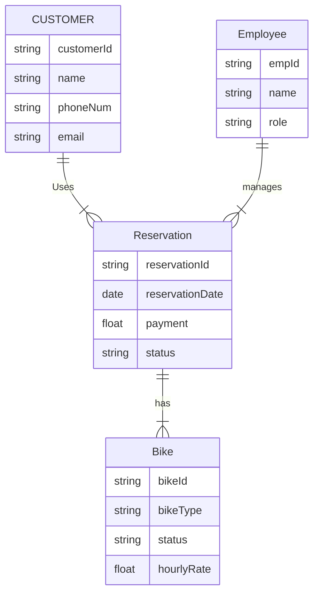
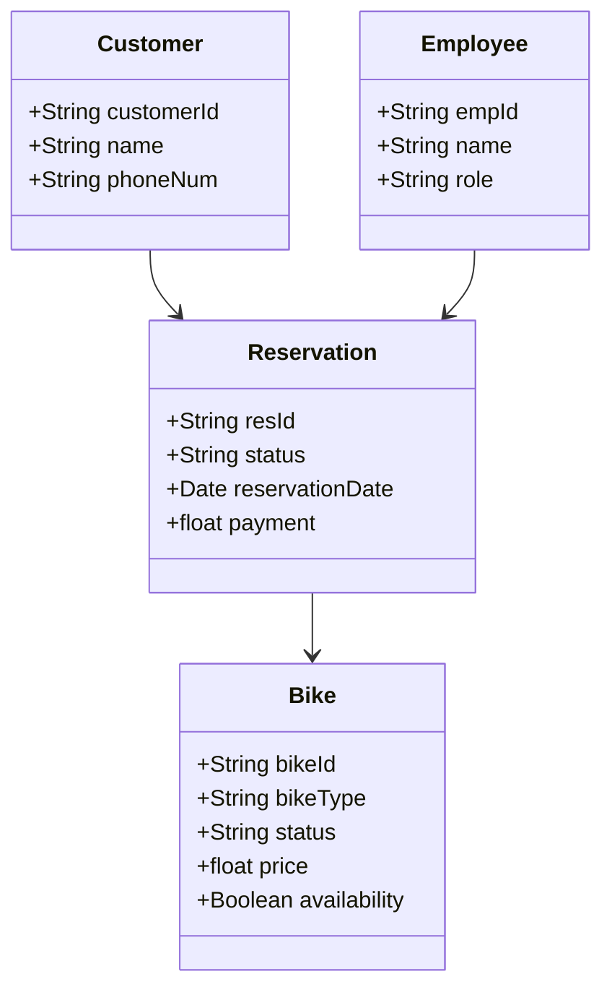

**Part 2**   
_Entity Relationship Diagram_  



<br><br><br>

_Class Diagram_



<br><br><br>

_Interfaces_

### 1.
Purpose: Customer searches for a type of bike

Requires:
- bikeList
- bikeType

Outcomes:
- Matching bikes are displayed

Guarantees:
- Only bikes matching the selected type are returned

Function:

```java
List<Bike> searchBike(String bikeType)
```

Returns:
- List of available bikes matching the bike type

<br><br>

### 2.
Purpose: Create reservation

Requires:
- reservationId
- customerId
- bike
- paymentId

Outcomes:
- Reservation is stored in the system

Guarantees:
- Reservation is linked to a customer and available bike

Code:

```java
Reservation createReservation(
    Bike bike,
    String customerId,
    String reservationId,
    String paymentId
)
```

Returns:
- Completed reservation object

<br><br>

### 3.
Purpose: Calculate cost of reservation

Requires:
- bikes
- reservation length

Outcomes:
- Total cost displayed to customer

Guarantees:
- Accurate price calculation based on bike rates and rental duration

Code:

```java
float calculateCost(
    List<Bike> bikes,
    int hours
)
```

Returns:
- Total reservation cost

<br><br>

### 4.
Purpose: Manager can generate a report

Requires:
- Report date

Outcomes:
- Daily report is generated

Guarantees:
- Accurate bike count, reservation count, and payment totals

Notes:
- Report summarizes activity for the selected day

Code:

```java
Report dailyReport(Date day)
```

Report Contains:
- Reservation count
- Payment totals
- Bike inventory count

<br><br>

### 5.
Purpose: Allows editing of reservation after it has been placed

Requires:
- reservationId
- bike
- price

Outcomes:
- Employee can add or remove bikes from reservation

Guarantees:
- Reservation data stays current and valid

Code:

```java
Reservation updateReservation(
    String reservationId,
    Bike bike,
    float price
)
```

Returns:
- Updated reservation

<br><br>

### 6.
Purpose: View information on bikes

Requires:
- bikeType

Outcomes:
- Displays details about bikes

Guarantees:
- Accurate information is shown for selected bikes

Code:

```java
List<Bike> viewBikeInfo(
    String bikeType
)
```

Returns:
- List of bikes and their attributes

<br><br>

_Invariants_

1. Bike availability is updated in real time.
2. Every reservation has a unique reservation ID.
3. Employees must have authorized access before managing reservations.
4. Every bike has a unique bike ID.
5. Reservations can only contain bikes currently marked as available.
6. Payment information must be attached before a reservation is finalized.

<br><br>

_Failure Modes_

1. Reservation fails to save and no reservation ID is generated.
   - System displays error and prevents confirmation.

2. Two customers attempt to reserve the same bike simultaneously.
   - First completed reservation receives the bike.
   - Second customer receives availability notification.

3. Payment does not process at checkout.
   - Reservation remains incomplete until payment succeeds.

4. Unavailable bikes are selected during reservation.
   - System blocks reservation and displays availability message.

5. Report generation fails due to missing reservation data.
   - System notifies manager and logs the error.

6. Bike inventory status does not update correctly.
   - Reservation process rechecks availability before confirmation.