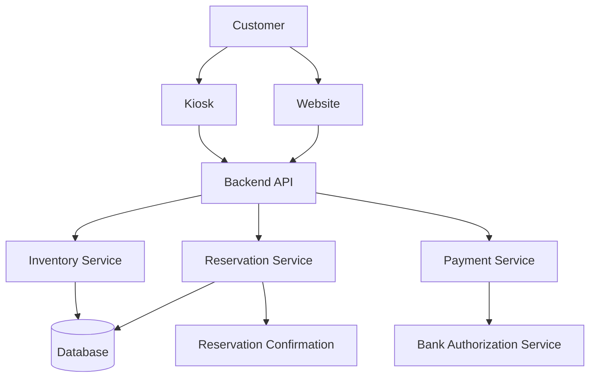

# Technical Design Document Review Report

**Document:** Bike Shop Software System – Technical Design Document  
**Author:** Yaremi Dominguez  
**Review Date:** November 2, 2026

## 1. Overall Assessment

The document establishes a reasonable foundation for a bike shop reservation system. It identifies the primary users, system goals, constraints, assumptions, and several major software components.

However, the document is currently incomplete and contains several logical, structural, and technical issues that should be addressed before it is considered a complete technical design document.

The most significant concerns include:

- System functionality and requirements are not sufficiently defined.
- Some actors are incorrectly classified or lack clear responsibilities.
- There are inconsistencies between the stated requirements and the component diagram.
- Reservation and payment processes lack important details.
- The component diagram does not accurately represent the complete system architecture.
- Several non-functional requirements are vague or lack measurable acceptance criteria.

## 2. Logical Issues

### 2.1 Inconsistent Reservation Functionality

The overview states that customers and employees can make reservations, while managers can manage reservations. However, the document does not explain what managing a reservation actually involves.

For example:
- Can employees modify existing reservations?
- Can customers cancel their reservations?
- Can customers modify reservation dates?
- Can employees cancel reservations on behalf of customers?
- Can managers override inventory availability?

**Recommendation:** Define the specific reservation operations available to each actor. Include creating, viewing, modifying, and canceling reservations where applicable.

### 2.2 Missing Reservation Details

The document mentions reservations but does not explain what information is required to create one.

For example, a reservation may require:
- Customer information.
- Selected bike or bikes.
- Reservation start date and time.
- Reservation return date and time.
- Payment information.
- Reservation confirmation.

Without defining these details, it is difficult to determine how the reservation system should function.

**Recommendation:** Include a brief description of the reservation workflow and identify the required reservation data.

### 2.3 Payment Process Is Underspecified

The Bank Authorization Service is listed as an actor, but its responsibilities are not fully explained.

The document mentions verifying account credentials and approving or canceling an amount. However, it does not clarify:
- Whether payments are processed immediately or authorized first.
- Whether customers receive refunds when reservations are canceled.
- What happens when a payment is declined.
- Whether the system stores payment information.
- Whether payment authorization and reservation creation occur together.

**Recommendation:** Explain the payment authorization process and how the system responds to successful and unsuccessful transactions. Clarify that sensitive payment information should be handled by an appropriate payment provider rather than unnecessarily stored by the bike shop.

### 2.4 Inventory and Maintenance Responsibilities Are Unclear

The Bike Maintenance actor is described as keeping real-time information on available bikes. However, the non-goals section states that connecting bike maintenance to the bike shop is outside the project's scope.

This creates a logical inconsistency.

If bike maintenance is responsible for updating bike availability, the document should explain how those updates reach the reservation system.

Additionally, a bike may be unavailable because it is:
- Currently rented.
- Under maintenance.
- Damaged.
- Reserved for a future date.

**Recommendation:** Clarify whether maintenance personnel or an external maintenance system updates inventory. Define the different bike availability statuses and explain how they affect reservations.

### 2.5 Conflicting Inventory Requirements

The constraints section states that inventory must be real-time, while the non-functional requirements state that inventory updates must appear online within one minute.

These requirements are not necessarily contradictory, but they describe different levels of update performance.

**Recommendation:** Define what real-time inventory means for this system. For example, reservation availability should be checked immediately before confirmation to prevent two customers from reserving the same bike, while general inventory updates must appear across the website and kiosk within 60 seconds.

### 2.6 Assumptions That May Not Be Realistic

The assumption that there will be no connectivity issues when creating reservations is unrealistic, especially because customers can use kiosks and employees depend on the system.

If connectivity is interrupted, the system could fail to create reservations or process payments.

**Recommendation:** Consider adding an error-handling requirement explaining what happens when the system loses connectivity during a reservation.

The assumption that customers always return bikes on time also needs clarification. Even though charges for unreturned bikes are a non-goal, late returns can still affect future reservations.

**Recommendation:** Explain whether late returns automatically make bikes unavailable for subsequent reservations.

## 3. Structural Issues

### 3.1 Missing Sections

The document currently contains an overview and an initial component diagram, but several important sections are missing from a complete technical design.

Recommended additional sections include:

- **Functional Requirements:** Detailed descriptions of what the system must do.
- **System Architecture:** Explanation of how the frontend, backend, database, and external services interact.
- **Database Design:** Description of important entities, relationships, and stored information.
- **Reservation Workflow:** Step-by-step explanation of how reservations are created and confirmed.
- **Payment Workflow:** Description of payment authorization and failure handling.
- **Security Design:** Explanation of authentication, authorization, data protection, and payment security.
- **Error Handling:** Description of how the system responds to invalid input, unavailable bikes, failed payments, and connectivity issues.
- **Testing Requirements:** Explanation of how the system's requirements will be verified.

**Recommendation:** Add these sections as appropriate for the assignment's required scope.

### 3.2 Actors Section Needs Better Organization

The current actors section mixes people, external services, and software interfaces.

For example:
- Customer is a human actor.
- Employee is a human actor.
- Manager is a human actor.
- Bank Authorization Service is an external system.
- Kiosk is a system interface rather than a human actor.
- Bike Maintenance may represent either a human role or an external system.

**Recommendation:** Separate human users from external systems and interfaces.

A possible organization would be:

**Human Actors**
- Customer
- Employee
- Manager
- Maintenance Personnel (if applicable)

**External Systems**
- Bank Authorization Service

**System Interfaces**
- Website
- Kiosk

This makes the system boundaries and responsibilities easier to understand.

### 3.3 Goals and Non-Goals Need More Precision

The goals section identifies general objectives but does not describe how success will be measured.

For example, "Allow reservations" is too broad.

A more specific goal would be:

"Allow customers to reserve available bikes by selecting a bike and specifying a rental start and end time."

Similarly, "Have secure payment processing" does not explain what security measures are expected.

**Recommendation:** Rewrite goals to describe specific system capabilities and ensure that non-goals clearly identify functionality that will not be implemented.

### 3.4 Non-Functional Requirements Are Mixed With Functional Requirements

Some items under Non-Functional Requirements are not sufficiently categorized.

For example:
- "Employees and manager need authenticated access" describes a security requirement.
- "Bike inventory additions/removals should be possible without redesigning the database" describes maintainability and scalability.
- "The reservation process is no more than 4 steps" describes a usability requirement.

**Recommendation:** Organize non-functional requirements into categories such as:

- Performance
- Security
- Usability
- Accessibility
- Scalability
- Maintainability
- Reliability
- Privacy

## 4. Component Diagram Issues

### 4.1 The Diagram Does Not Represent the Complete System

The current diagram illustrates a basic customer reservation process:

Customer → Website/Kiosk → Bike Inventory → Cart → Review → Payment → Receipt.

However, it does not include several components mentioned elsewhere in the document.

Missing components include:
- Backend API.
- Database.
- Employee interface.
- Manager interface.
- Reservation management.
- Authentication system.
- Bank Authorization Service.
- Reporting functionality.
- Inventory management functionality.

**Recommendation:** Expand the diagram to represent the main architectural components and their relationships.

### 4.2 The Kiosk and Website Do Not Connect to the Same Backend API

The constraints section specifically states that the kiosk interface uses the same backend API as the website.

However, the diagram shows both interfaces connecting directly to Bike Inventory.

This does not clearly demonstrate the shared API requirement.

**Recommendation:** Add a Backend API component between the interfaces and the system's internal services.

For example:

This is a more accurate representation of the shared backend architecture.

### 4.3 Missing Employee and Manager Interfaces

The overview explains that employees and managers have access to different system functionality, but neither appears in the diagram.

**Recommendation:** Add employee and manager interfaces and show how they communicate with the backend API.

For example:
- Employees access reservation management.
- Managers access reports and inventory management.
- Both authenticate through the existing login system.

### 4.4 Component Descriptions Are Too Brief

The component descriptions provide basic explanations, but they do not explain the responsibilities or interactions of each component in sufficient detail.

For example, the Bike Inventory component is described only as providing real-time availability.

It should also explain:
- How inventory information is updated.
- How availability is checked.
- How overlapping reservations are prevented.
- How maintenance-related unavailability is handled.

**Recommendation:** Expand component descriptions to include each component's responsibilities, inputs, outputs, and interactions with other components.

### 4.5 Missing Reservation Management Component

The diagram moves from payment directly to a receipt page without explicitly showing when the reservation is created or stored.

This is a significant omission because payment authorization and reservation creation are two separate operations.

**Recommendation:** Include a Reservation Service that validates bike availability, creates the reservation, and stores the reservation information.

The system should also account for situations where payment succeeds but reservation creation fails, or vice versa.

## 5. Non-Functional Requirement Issues

### 5.1 Performance Requirement Is Too Vague

The requirement states:

"Must be able to handle 100 requests at the same time."

It is unclear whether this means 100 concurrent users, 100 simultaneous API requests, or 100 reservation transactions.

It also does not define acceptable response times.

**Recommendation:** Rewrite this requirement to be measurable.

Example:

"The system must support at least 100 concurrent users while maintaining an average response time of less than two seconds for inventory searches."

The exact performance target should be determined by the project's expected workload.

### 5.2 Inventory Update Requirement Needs Clarification

The requirement that inventory updates appear online within one minute is useful, but it does not specify whether this applies to all inventory changes or only administrative updates.

**Recommendation:** Define the expected update time for different operations. Reservation availability should be validated immediately before a reservation is confirmed, rather than relying on potentially outdated inventory information.

### 5.3 Accessibility Requirement Is Too General

The document states that the kiosk must meet accessibility guidelines.

However, it does not identify which guidelines or what accessibility features are required.

**Recommendation:** Consider referencing WCAG 2.2 Level AA as a target for applicable web and kiosk interfaces, while identifying relevant requirements such as:
- Keyboard accessibility.
- Screen reader compatibility.
- Sufficient color contrast.
- Readable text.
- Accessible form labels.
- Clear error messages.

### 5.4 Security Requirements Need More Detail

The document mentions authentication and compliance with CCPA and GDPR but does not describe how security will be implemented.

**Recommendation:** Consider adding requirements for:
- Role-based access control.
- Secure communication using HTTPS.
- Secure password handling through the existing authentication system.
- Protection of customer information.
- Secure payment processing.
- Audit logging for employee and manager actions.

## 6. Missing Examples and Scenarios

Because the document is a technical design document, including examples would help demonstrate how the system is expected to behave.

The following examples would strengthen the design.

### 6.1 Example: Customer Reservation

A customer visits the website and searches for an available bike. The customer selects a bike, chooses a rental start and end time, reviews the reservation details, and proceeds to payment.

The system checks that the bike is available for the selected time period. If payment authorization succeeds, the reservation is saved and the customer receives a confirmation.

If the bike is no longer available, the system informs the customer and asks them to select another bike or rental period.

### 6.2 Example: Employee Reservation Management

An employee logs into the system using the shop's existing authentication system. The employee searches for a customer's reservation and views its details.

The employee can modify or cancel the reservation, depending on the permissions assigned to their account.

### 6.3 Example: Manager Inventory Management

A manager logs into the system and opens the inventory management interface.

The manager adds a new bike to the inventory, including its identification number, model, and rental price.

The system saves the bike information and updates its availability across the website and kiosk.

### 6.4 Example: Failed Payment

A customer selects a bike and proceeds to checkout.

The Bank Authorization Service declines the payment. The system does not confirm the reservation and displays an error message explaining that the payment could not be authorized.

The customer can attempt payment again using another payment method.

### 6.5 Example: Overlapping Reservations

Two customers attempt to reserve the same bike for overlapping time periods.

The first customer completes the reservation successfully. When the second customer attempts to confirm their reservation, the system checks availability again and identifies the scheduling conflict.

The second customer is notified that the bike is unavailable for the selected time period.

## 7. Grammar, Formatting, and Consistency Issues

The document contains several spelling, capitalization, grammatical, and formatting errors.

Examples include:

| Current wording | Suggested correction |
|---|---|
| Bank Authotization Service | Bank Authorization Service |
| real-time bike inventory | Real-time bike inventory |
| inventory andavailability | inventory and availability |
| Allow customersto view inventory | Allow customers to view inventory |
| bike innventory | bike inventory |
| shouldbe possible | should be possible |
| accessability guidelines | accessibility guidelines |
| peak trafficis | Peak traffic is |
| most reservations | Most reservations |
| Bike maintenance:keep | Bike maintenance: keep |
| Pull reports | Generate reports |
| reciept page | receipt page |

Additional formatting issues:

- Heading styles are inconsistent.
- Some section titles use underscores instead of standard Markdown headings.
- The component table contains unnecessary bold formatting and inconsistent spacing.
- Some bullet points do not have spaces after their asterisks.
- Capitalization is inconsistent across sections.
- The abbreviation "Non-Functional Recs" should be changed to "Non-Functional Requirements."
- Some descriptions use incomplete sentences.
- The document should use consistent terminology for reservations, rentals, inventory, and payments.

**Recommendation:** Use consistent Markdown heading levels, bullet formatting, capitalization, and terminology throughout the document.

## 8. Priority of Recommended Changes

| Priority | Issue | Reason |
|---|---|---|
| High | Clarify reservation workflow | Core functionality of the system |
| High | Clarify payment and reservation processing | Prevents inconsistent transactions |
| High | Expand component diagram | Current diagram does not represent the complete architecture |
| High | Resolve maintenance and inventory responsibilities | Current requirements conflict |
| High | Define reservation data and availability rules | Necessary for correct system behavior |
| Medium | Add database and security design | Improves technical completeness |
| Medium | Improve non-functional requirements | Makes requirements measurable |
| Medium | Add example scenarios | Demonstrates expected system behavior |
| Low | Correct spelling and formatting | Improves readability and professionalism |

## 9. Final Assessment

The document provides a good starting point for the technical design of a bike shop reservation system. It identifies the primary purpose of the application and establishes several important requirements, including real-time inventory updates, secure payment processing, kiosk functionality, and employee authentication.

However, the biggest weakness is that the document describes *what the system should accomplish* without sufficiently explaining *how the system will accomplish it*.

The most important improvements are to define the reservation and payment workflows, clarify the responsibilities of each actor and component, and expand the architecture diagram to include the backend API, database, reservation management, authentication, and external payment services.

Additionally, the document would benefit from concrete examples demonstrating normal and exceptional system behavior. These examples would help establish a clearer understanding of the expected functionality and expose potential design problems before implementation.

**Overall conclusion:** The document has a solid initial foundation, but it needs additional technical detail, clearer system boundaries, more precise requirements, and improved architectural documentation to function as a complete technical design document.