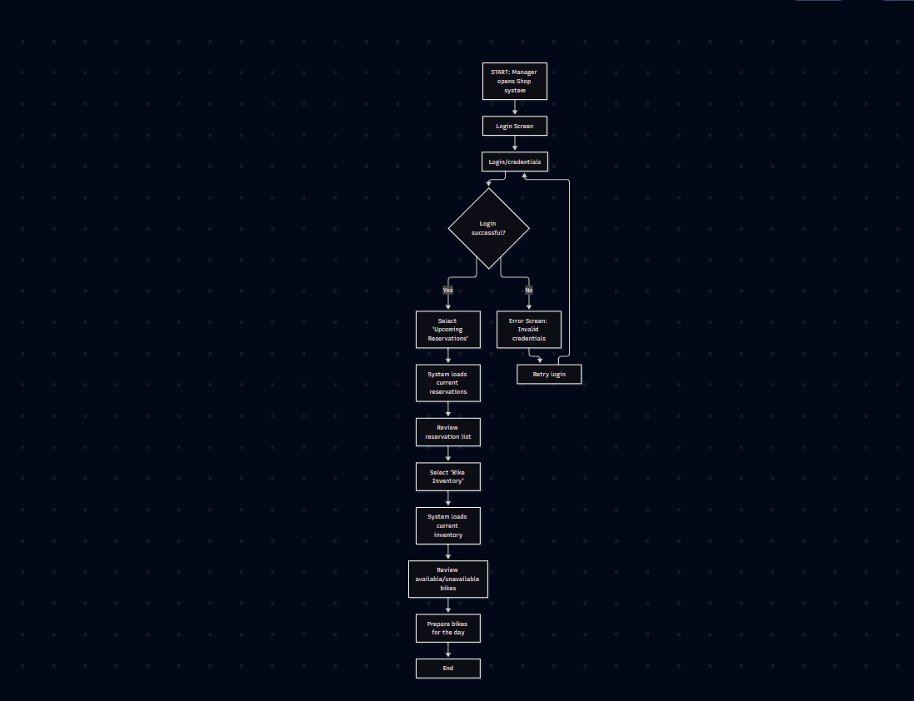
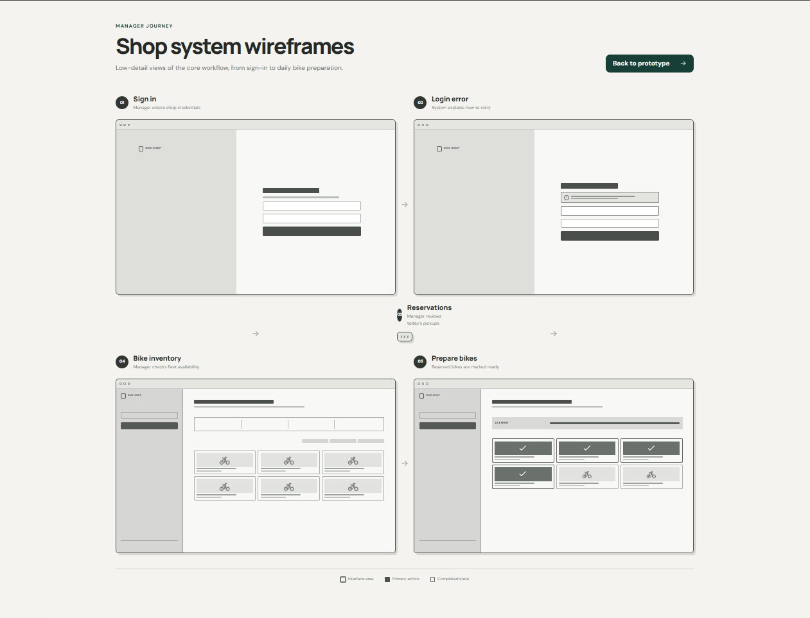

## Project 3
_Yaremi Dominguez_  
_October 16, 2026_

**UX Flow of Bike Shop Manager**
```mermaid
[flowchart TD
    A[START: Manager opens Shop system] --> B[Login Screen]
    B --> C[Login/credentials]

    C --> D{Login successful?}
    D -->|Yes| E[Select 'Upcoming Reservations']
    D -->|No| F[Error Screen: Invalid credentials]
    F --> G[Retry login]
    G --> C

    E --> H[System loads current reservations]
    H --> I[Review reservation list]

    I --> J[Select 'Bike Inventory']
    J --> K[System loads current inventory]

    K --> L[Review available/unavailable bikes]
    L --> M[Prepare bikes for the day]
    M --> N[End] 
]
```  
  

**Bike Manager Wireframes**  
I used Figmamake to creat wireframes for the bike manager




**Manager functioning prototype**  
I used Figmamake to create my usable worktype: <https://www.figma.com/make/oxs0460uyYnzljP91ooK5K/Prototype-mockup-SPA?fullscreen=1&t=ADRUasHuqZcs6Rgb-1&code-node-id=0-6>

1. The sign in screen shows where the manager has to input his credentials. This screen doesnt take into account if the credentials worked or not, just shows the page.
2. Page two is still the sign in page but if the log in didnt work. The circle with exclamation mark pops up a warning saying the credentials didnt work and to try again.
3. Page three is once the log in works. The page shows bikes and their availability. Reserved or available.
4. Page four looks similar to page three, but now has checks that indicate if bikes are ready for pickup. The checks can be unchecked if they arent ready for pickup yet.