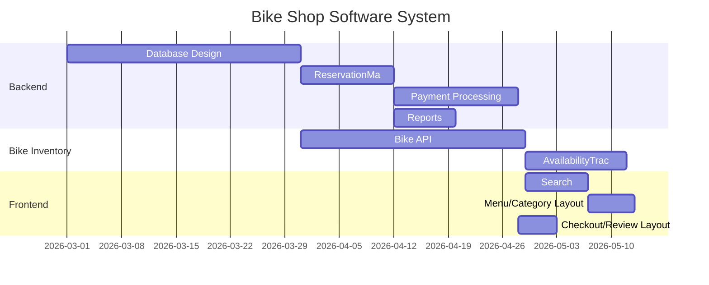

## Project 6
_Yaremi Dominguez_  
_November 16, 2026_  

**Estimation**
* Bike Shop Software System(100%)
    * Front end(35%)  
        * Menu/Category Layout(10%)
        * Checkout/Review Layout (10%)
        * Search(15%)
    * Backend(45%)  
        * Database Design(15%)
        * Reservation management(10%)
        * Payment processing(10%)
        * Reports(5%)
    * Bike Inventory(25%)   
        * Bike API(15%)  
        * Availability Tracking(10%)

**PERT: (O,M,P)**
* Menu/Category Layout: 3,6,10
* Checkout/Review Layout: 2,5,7
* search:4,8,12
* Database Design: 20,30,40
* Reservation management: 8,12,18
* Payment processing:10,15,25
* Reports: 5,8,12
* Bike Inventory API: 20,28,40
* Availability Tracking: 8,12,20

**Scheduling**
* Menu/Category Layout: 6.17
* Checkout/Review Layout:4.83
* search: 8
* Database Design: 30
* Reservation management: 12.33
* Payment processing: 15.83
* Reports: 8.17
* Bike Inventory API: 28.67
* Availability Tracking: 12.67

**CPM Table**
| Task | Duration | Depends On | ES | EF | LS | LF | Slack |
|------|----------|------------|----|----|----|----|-------|
| A: Database Design | 30 | None | 0 | 30 | 0 | 30| 0 |
| B: Bike API | 28.67 | A | 30 | 58.67 | 30 | 58.67 | 0 |
| C: Availability Tracking | 12.67 | B | 58.67 | 71.34 | 60.17 | 72.84 | 1.50 |
| D: Reservation Management | 12.33 | A | 30 | 42.33 | 42.51 | 54.84 | 12.51 |
| E: Payment Processing | 15.83 | D | 42.33 | 58.16 | 54.84 | 70.67 | 12.51 |
| F: Search | 8 | B | 58.67 | 66.67 | 58.67 | 66.67 | 0|
| G: Menu/Category Layout | 6.17 | F | 66.67 | 72.84 | 66.67 | 72.84 | 0 |
| H: Checkout/Review Layout | 4.83 | E | 58.16 | 62.99 | 68.01 | 72.84 | 9.85 |
| I: Reports | 8.17 | D | 42.33 | 50.50 | 64.67 | 72.84 | 22.34 |

**Gantt Chart**

